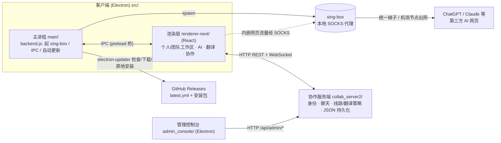

# 架构总览

ShareGPT 由三端组成：**客户端**（Electron 桌面应用）、**协作服务端**（`collab_server2/`）、**管理控制台**（`admin_console/`）。客户端可以使用完全本地的个人工作区，也可以连接自托管团队；代理能力基于 [sing-box](https://sing-box.sagernet.org/)，自动更新基于 GitHub Releases。

## 各端职责

- **客户端 `src/`**
  - `main/`（纯 Node 主进程）：窗口与 `WebContentsView` 生命周期、持久 Chromium 分区、路由授权、`spawn` sing-box、受限 composer/翻译桥接和自动更新。核心在 `backend.js`、`appFactory.js`。
  - `renderer-next/`（React + TS）：首次使用引导、个人/团队工作区、AI 多标签与多环境、翻译、协作聊天和设置。通过 `preload.js` 暴露的受限 IPC 与主进程通信。
  - `updateService.js`：独立负责 GitHub Latest 解析、更新传输代理选择和候选下载。`backend.js` 保留现有更新调用入口，设置、账号资料和升级备份仍由原模块管理。
- **协作服务端 `collab_server2/`**：Node `http` + `ws` 服务。负责账号、会话、聊天、客户端 bootstrap、线路授权、托管翻译与用量。数据以原子写方式保存到独立 JSON 文件；不同实例必须使用不同端口、数据目录和翻译主密钥。
  - `team_calendar.js` 集中处理团队日历的事件、参与状态、团队边界与持久化。它复用现有账号会话和广播连接，日历文件损坏时保留原件并尝试上一份有效备份，没有有效备份时停止读写。
- **管理控制台 `admin_console/`**：独立 Electron，调用 `/api/admin/*` 管理用户、团队网络、多线路授权、各 AI 推荐线路、托管翻译、反馈和版本信息。

## 源码与构建目录

| 目录                 | 内容                                           |
| -------------------- | ---------------------------------------------- |
| `src/main/`          | 客户端主进程、本机能力与对应测试               |
| `src/renderer-next/` | 当前客户端 React 界面、组件与前端测试          |
| `collab_server2/`    | 协作服务、数据访问与服务端测试                 |
| `admin_console/`     | 管理控制台主进程与 `ui/` 界面                  |
| `scripts/`           | 构建、资源准备与行为验收入口                   |
| `docs/`              | 架构、自托管、兼容与发布说明                   |
| `build/`             | 图标、打包素材与本机准备的代理二进制           |
| `legacy/`            | 历史界面和旧接收端构建配置，不进入客户端安装包 |

当前桌面入口为 `src/main/main_sender.js`，主界面和个人资料窗口均加载 `renderer-next` 的构建结果。历史界面保存在 `legacy/renderer/`；`src/main/main_receiver.js` 仅作为旧模式兼容验收入口保留，其构建配置位于 `legacy/receiver/build.json`，不作为日常客户入口。

`node_modules/`、各界面的 `dist/` 及 `release*` 构建产物不是源码；依赖按对应锁文件安装，生成文件通过现有构建命令更新。版本由 Git 提交和发布标签标识。

出站接口的地址分类、DNS 结果检查与固定地址连接共用 `collab_server2/shared/endpointSecurity.js`。它不依赖 Electron，随独立服务器目录部署；客户端通过 `src/main/endpointSecurity.js` 保留原导入入口，打包配置只纳入这份共享模块，不包含服务器业务或资料文件。客户端明确配置的本机离线接口保留回环例外，服务端翻译上游使用仅公网策略。

界面同步由 `src/renderer-next/src/lib/accountSync.ts` 统一管理账号归属、取消、传输、版本、队列与恢复。日历/待办、笔记和网页环境的 hook 只提供各自的数据适配，保留删除标记、笔记三方合并和网页策略的不同规则。网页策略使用 `browserPrivacySyncPolicy.ts` 中的实际运行算法，保存和应用交由 `browserPrivacyRuntime.ts`，手动/自动出口检测复用同一账号边界。

AI 页面中的 `useProxyHealth.ts` 独立管理代理巡检、缺失域名处理和重试，工作区组件负责页面布局与操作组合。原生网页的创建、附着与恢复继续通过主进程原有的统一协调入口处理。

## 关键协议 / 链路

| 链路                | 方式                  | 说明                                                                      |
| ------------------- | --------------------- | ------------------------------------------------------------------------- |
| 渲染层 ↔ 主进程     | Electron IPC          | 见 `src/main/preload.js` 暴露的 `api.*`                                   |
| 客户端 ↔ 协作服务端 | HTTP REST + WebSocket | 鉴权用 `Authorization: Bearer <token>`（非 cookie）；WS 推送在线状态/消息 |
| 内嵌 AI 网页 ↔ 外网 | sing-box SOCKS        | 个人代理或团队授权线路；每个 AI 分区绑定明确线路并在变更时重新验证        |
| 自动更新            | GitHub Releases       | GitHub Latest Release tag 是版本权威；安装元数据不能覆盖不匹配的 tag      |

## 数据与持久化（服务端）

- `users.json`、`chat_history.json`、`gpt_usage.json`、`client_bootstrap.json`、`proxy_routes.json`、`translation_profiles.json`、`translation_usage.json` 等通过原子替换写入，避免留下半个 JSON 文件。
- 路径可经环境变量覆盖（`USERS_FILE` / `CHAT_HISTORY_FILE` / …），多群部署即指向不同目录。
- 翻译 API Key 只以 AES-256-GCM 密文保存在服务端，主密钥来自环境变量且不下发客户端；数据目录与主密钥都必须纳入受控备份。

## 本机资料与账号切换（1.0.10）

- `principalData.js` 管理 `PrincipalData/<stablePrincipal>` 下的日历、待办、专注、团队聊天缓存及知识库归属。个人工作区使用独立的 `local-device`，不复用组织资料。
- 账号切换通过同一资料生命周期保存当前编辑内容、结束旧请求、装载目标资料；保存失败时不继续切换。IPC 和同步回调均检查发起时的账号与代次。
- 旧全局资料不因升级自动归入某个账号。用户从“账户 → 本机资料”确认类别与归属后复制接续，原件和已有目标资料保留。
- Chromium 网页分区与这些业务文件分别管理。已验证的同一服务器入口别名继续使用已有存储身份与分区名称；不能只凭用户名相同跨团队复用资料。

## 继续维护

- 已实施功能、验证证据、服务器增量更新原则和踩坑记录：
  [`IMPLEMENTATION_HISTORY.md`](IMPLEMENTATION_HISTORY.md)
- 每次发布的构建与资产清单：[`RELEASING.md`](RELEASING.md)
- 浏览器数据清理、环境配置和网页可见信息边界：[`browser-privacy.md`](browser-privacy.md)
- 从空服务器开始自托管：[`SELF_HOSTING.md`](SELF_HOSTING.md)
